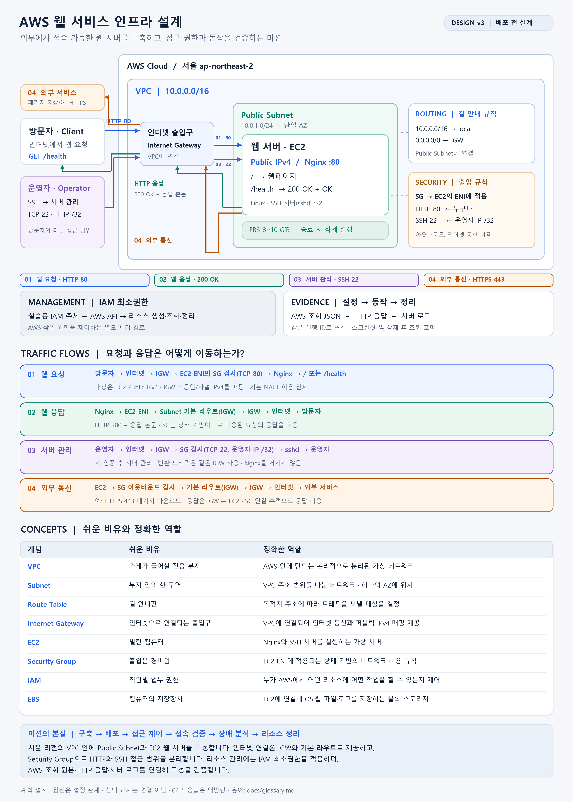
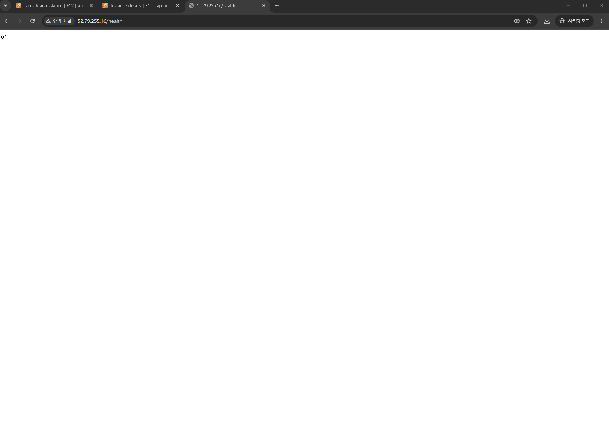
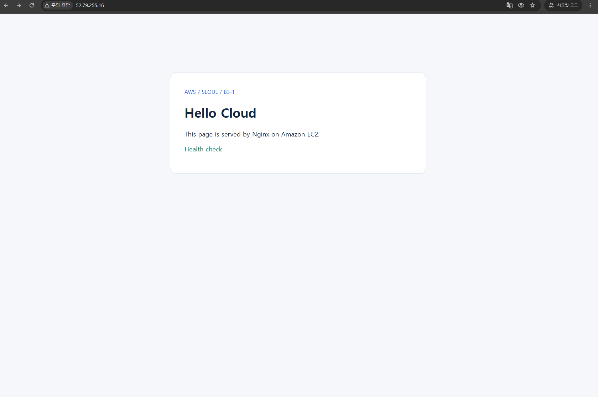

# B3-1 · AWS 기초 웹 인프라 구축

서울 리전의 VPC 안에 Public Subnet과 EC2/Nginx 웹 서버를 구성했습니다. HTTP는 공개하고 SSH는 운영자 IP로 제한했으며, 설정 확인·외부 응답·서버 access log로 동작을 확인했습니다.


## 0. 프로젝트 안내

| 확인할 내용 | 바로 보기 |
| --- | --- |
| 서비스 구조와 용어 | [아키텍처](docs/architecture.png) · [설계 설명](docs/architecture-design.md) · [Glossary](docs/glossary.md) |
| 외부에서 실제 응답하는가? | [접속 화면](docs/images/external-health.png) |
| 서버 내부도 정상인가? | [서버 검증 로그](evidence/server/20261021T192610Z-fecfd7c3/verification.log) |
| 오류를 어떻게 해결했는가? | [트러블슈팅 보고서 — IAM 조회 권한 누락 1건](docs/troubleshooting.md) |
| 정리 완료 여부 | [리소스 정리 체크리스트](docs/cleanup-checklist.md) |

## 1. 아키텍처와 요청 흐름



다이어그램은 설계 설명용 v3입니다. 실제 배포 자원 ID는 [추적 기록](docs/cleanup-checklist.md)에 있습니다. EC2·EBS를 1개씩 사용한 단일 AZ 실습 구성입니다.

| 흐름 | 경로 | 의미 |
| --- | --- | --- |
| 웹 요청 | 방문자 → 인터넷 → IGW → EC2 ENI의 SG 검사 → Nginx :80 | 공개한 웹 서비스에 접근 |
| 웹 응답 | Nginx → EC2 ENI → Subnet의 기본 라우트 → IGW → 방문자 | 요청에 대한 페이지 또는 OK 반환 |
| 서버 관리 | 운영자 → IGW → SG의 IP 제한 → sshd :22 | 개인키로 SSH 로그인 |
| 서버 외부 통신 | EC2 → SG 아웃바운드 → 기본 라우트 → IGW → 외부 서비스 | 패키지 다운로드 및 외부 HTTPS 요청 |

IGW는 VPC에 연결합니다. Route Table은 Subnet에 연결해 경로를 정하며, 별도의 중계 서버가 아닙니다. SG는 서버의 네트워크 통신을, IAM은 AWS API 작업 권한을 제어합니다.

## 2. 실제 구성

| 자원 | 설정 |
| --- | --- |
| VPC | `10.0.0.0/16` |
| Public Subnet | `10.0.1.0/24`, `ap-northeast-2a` |
| IGW | 실습 VPC에 연결 |
| Route Table | 내부 `local`, 기본 경로 `0.0.0.0/0 → IGW`, 실습 Subnet 명시적 연결 |
| EC2 | Amazon Linux 2023, `t3.micro`, 퍼블릭 IPv4, 실습 Subnet·SG 적용 |
| EBS | gp3 8 GiB, `DeleteOnTermination=true` |
| SG | 인바운드 TCP 80 전체 IPv4, TCP 22 운영자 공인 IP `/32`; 아웃바운드 전체 IPv4 |
| Nginx | `/` 웹페이지, `/health`는 200과 `OK` |
| IAM | 실습용 IAM 사용자 `b3-1-lab`; 서울 리전 작업, EC2 유형 제한 |

`b3-1-lab`에는 실습에 필요한 EC2/VPC 정책과 기본 로그인 정책만 연결했습니다. 관리자 권한은 부여하지 않았으며, 연결된 정책 본문은 [IAM 정책 코드](infra/iam-policy.json)와 일치합니다. 그룹에는 소속되지 않은 독립 IAM 사용자입니다.

AWS 리소스는 `Project=b3-1` 태그와 생성 당시 기록한 리소스 ID를 기준으로 추적했습니다.

## 3. 외부 접속 검증 — 방식 B

- 선택한 방식: **B — 외부 GET /health**
- 검증 당시 URL: **http://52.79.255.16/health**
- 결과: **HTTP 200**, 고정 응답 **`OK`**
- 이 주소는 실습 당시 주소입니다. 정리 후에는 접속되지 않는 것이 정상입니다.



**보조 확인 — 메인 페이지:** `http://52.79.255.16/`에서도 Nginx가 제공하는 Hello Cloud 페이지가 표시됩니다. 기본 검증 방식은 B로 유지하며, 아래 사진은 웹페이지 표시 결과를 추가로 보여줍니다.




**Nginx는 브라우저의 HTTP 요청을 받아 웹페이지나 응답을 보내는 웹 서버 프로그램입니다.** `Welcome to nginx!`는 Nginx 설치 직후 제공되는 기본 페이지입니다.

이번 실습에서는 [초기 설정 스크립트](infra/user-data.sh)가 `/usr/share/nginx/html/index.html`을 Hello Cloud 페이지로 교체했습니다. 따라서 Hello Cloud가 보이는 것은 Nginx가 우리가 설정한 HTML 파일을 정상적으로 제공하고 있음을 보여줍니다.

| 요청 경로 | Nginx의 응답 | 확인 목적 |
| --- | --- | --- |
| `/` | Hello Cloud HTML 페이지 | 사용자가 웹페이지를 볼 수 있는지 확인 |
| `/health` | HTTP 200과 고정 본문 `OK` | 서버가 요청에 정상 응답하는지 간단히 확인 |

외부 요청에 `evidence=20261021T190713Z-a002c911`을 붙였습니다. [Nginx access log](evidence/server/20261021T192610Z-fecfd7c3/verification.log)에서 해당 요청의 `status=200`을 확인했습니다. 접속 사진은 별도로 `/health`의 OK 응답을 보여줍니다.

| 검증 항목 | 실제 결과 |
| --- | --- |
| SSH 로그인 | Amazon Linux 로그인 배너와 `ec2-user` 프롬프트 확인 |
| Nginx 프로세스 | `systemctl is-active nginx` → `active` |
| 내부 웹 요청 | `curl http://localhost/` → `HTTP/1.1 200 OK` |
| 서버의 외부 통신 | `https://example.com` → HTTP 200, curl 종료 코드 0 |
| 외부 요청 처리 | 동일 evidence 값의 access log, `status=200` |

[서버 검증 로그](evidence/server/20261021T192610Z-fecfd7c3/verification.log)에는 Nginx 실행 상태·내부 HTTP 200·외부 통신 성공·외부 요청 처리 결과만 발췌했습니다. 전체 원본 로그가 아니며, 명령 표기는 실행 맥락을 설명하기 위해 추가했습니다. SSH 접속 후 확보한 출력이고 검증 시각은 2026-10-21 19:18:27 UTC입니다. UTC에 9시간을 더하면 한국 시간입니다.


## 4. 실행 환경과 확인 방법

로컬은 Windows PowerShell, AWS CLI v2, OpenSSH를 사용합니다. 서버는 Amazon Linux 2023이며 SSH 로그인 이름은 `ec2-user`입니다. 이번 구축은 콘솔로 수행했고 `user-data.sh`는 첫 부팅 시 Nginx를 초기 설정하는 데 사용했습니다. 인프라 전체 자동 배포를 구현했다고 주장하지 않습니다.

```powershell
# CLI 인증 후 실제 사용자 확인
aws sts get-caller-identity --profile b3-1-lab --region ap-northeast-2

# 외부 HTTP 검증
curl.exe -i http://52.79.255.16/health

# 개인키는 저장소 밖의 실제 보관 위치 사용
ssh -i "$env:USERPROFILE\Desktop\b3-1-key.pem" ec2-user@52.79.255.16
```

서버에서 실행한 주요 확인 명령:

```bash
systemctl is-active nginx
curl --fail -i http://localhost/
curl --fail --silent --output /dev/null --write-out 'HTTP %{http_code}\n' https://example.com
sudo grep -F 'evidence=20261021T190713Z-a002c911' /var/log/nginx/access.log
```


## 5. 트러블슈팅

EC2 생성 화면에서 기존 Security Group을 선택할 때 `ec2:GetSecurityGroupsForVpc` 권한 부족 오류가 발생했습니다. 생성 작업 권한은 있었지만, 콘솔이 선택한 Security Group을 확인하는 조회 권한이 정책에 빠져 있었기 때문입니다. `b3-1-lab`의 IAM 정책에 해당 Action을 추가하고 저장한 뒤 재시도하여 정상 진행을 확인했습니다.

자세한 증상·가설·검증·조치·결과·재발 방지는 [트러블슈팅 보고서](docs/troubleshooting.md)에서 확인할 수 있습니다.

## 6. 전체 프로젝트 구조

```text
3-1/
├─ README.md
├─ .gitignore
├─ docs/
│  ├─ architecture.png             # 제출 규격 호환용 설계도
│  ├─ architecture-design.md        # 설계 설명
│  ├─ troubleshooting.md            # IAM 권한 오류 1건
│  ├─ cleanup-checklist.md           # 정리 대상과 완료 근거
│  ├─ glossary.md                   # 용어 사전
│  └─ images/
│     ├─ external-health.png        # 외부 접속 화면
│     ├─ external-home.png          # 메인 페이지 보조 증빙
│     ├─ troubleshooting-before.png # 오류 화면
│     └─ troubleshooting-policy-edit.png # 정책 수정 화면
├─ infra/
│  ├─ iam-policy.json               # 권한 설정
│  └─ user-data.sh                  # Nginx 초기 설치·설정
└─ evidence/
   └─ server/<실행ID>/verification.log # 서버 검증 로그 1개
```

**제출 규격:** 아키텍처 이미지는 과제에서 지정한 `docs/architecture.png` 한 곳에만 둡니다. README와 설계 설명도 이 경로를 사용합니다. `README.md`와 접속 스크린샷, `docs/troubleshooting.md`, `docs/cleanup-checklist.md`도 유지합니다. 아키텍처 설명 MD와 Glossary도 함께 제공합니다. 증빙은 요구사항을 확인하는 핵심 자료만 남겼습니다.

## 파일 읽는 기준

**이 README가 제출의 시작점**입니다. `docs`는 설명 문서, `infra`는 실제 설정 코드, `evidence`는 핵심 증빙입니다. 트러블슈팅 제출은 IAM 조회 권한 누락 **1건**입니다.

서버 검증 로그는 실습 당시 결과이며 운영자 IP를 `[REDACTED_OPERATOR_IP]`로 가렸습니다. 계정 식별정보가 포함된 조회 JSON은 제출에서 제외하고 설정·검증 결과를 문서에 정리했습니다.
