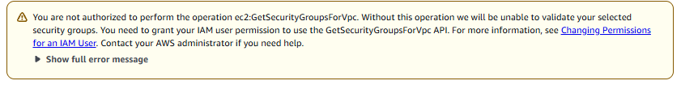
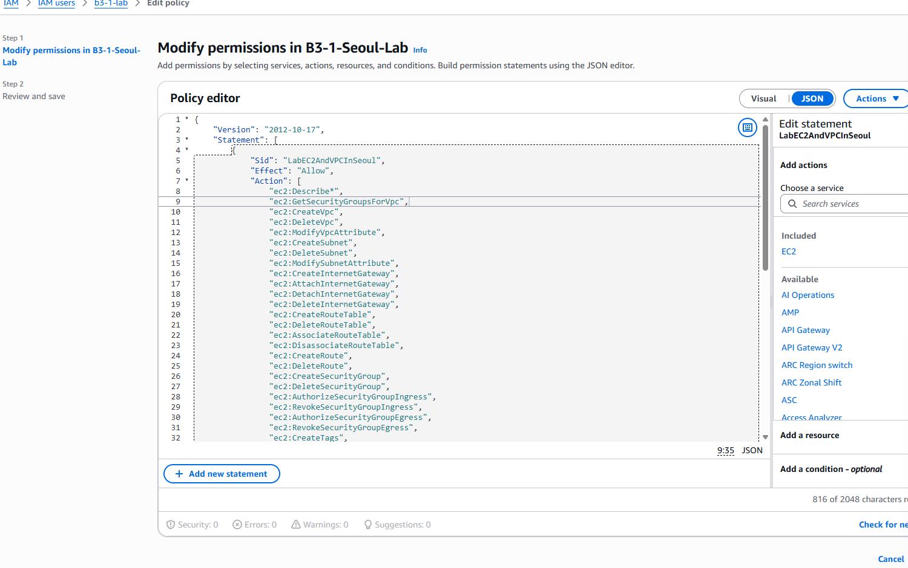

# 트러블슈팅 · 보안 그룹을 확인할 IAM 권한이 없었던 문제

> **문제:** 서버의 출입 규칙은 만들었지만, 그 규칙을 조회할 작업 권한 하나가 빠졌다.
>
> **해결:** 필요한 조회 권한만 추가하고, 같은 API를 실습용 IAM 사용자 `b3-1-lab`로 다시 실행해 성공을 확인했다.

## 1. 증상 — 어디에서 무엇이 안 됐나?

`b3-1-lab`으로 서울 리전에서 EC2를 생성하던 중, `b3-1-web-sg`를 선택하자 노란 권한 경고가 표시됐다. **아직 서버를 실행하기 전, 콘솔이 SG를 확인하는 단계**였다.



**사진에서 볼 곳:** 노란 오류 상자의 `ec2:GetSecurityGroupsForVpc`. 

```text
You are not authorized to perform the operation ec2:GetSecurityGroupsForVpc.
Without this operation we will be unable to validate your selected security groups.
```

첫 문장은 **“현재 요청에 해당 API를 실행할 권한이 없다”**, 두 번째 문장은 **“그래서 선택한 보안 그룹을 검증할 수 없다”**는 뜻이다.

**‘검증하지 못했다’와 ‘보안 그룹이 잘못됐다’는 다르다.** 확인할 허가가 없어 판단 단계까지 진행하지 못한 것이다. 이 메시지만으로 SG의 HTTP·SSH 규칙이 올바른지까지 판단할 수는 없다.

### 메시지가 알려주는 사실과 아직 확인할 사항

| 메시지에서 알 수 있는 것 | 아직 확인해야 하는 것 |
| --- | --- |
| 실패한 작업은 `ec2:GetSecurityGroupsForVpc`이다. | 실제 호출자는 누구이며, 의도한 실습용 IAM 사용자 `b3-1-lab`로 요청했는가? |
| 해당 요청이 권한 문제로 허용되지 않았다. | Allow 누락인가, 리전 등 Condition 불일치인가, 다른 정책의 명시적 Deny인가? |
| 콘솔이 선택한 SG의 사용 가능 여부를 검증하지 못했다. | 실제 대상 VPC·SG는 무엇이며 서로 올바르게 연결되어 있는가? |
| API 이름이 오류에 명시되어 조사 대상을 좁힐 수 있다. | 어느 정책의 어느 부분이 원인인지, 수정 후 같은 작업이 성공하는가? |

이번 메시지는 실패한 API를 알려줘 비교적 구체적이다. 그러나 어떤 정책에서 왜 거부됐는지까지 설명하지는 않는다. **오류 메시지는 원인을 확정하는 정답이 아니라, 조사 방향을 정하는 단서**로 사용했다.

## 2. 가설 — 왜 발생했다고 생각했나?

오류가 권한 문제와 실패한 API를 지목했으므로, 먼저 초기 IAM 정책의 Allow 목록을 대조했다. `ec2:Describe*`는 있었지만 `ec2:GetSecurityGroupsForVpc`가 없었다. 이를 근거로 **‘필요한 Allow가 누락됐다’**는 가설을 세웠다.

```text
Describe* → Describe로 시작하는 작업만 허용
GetSecurityGroupsForVpc → Get으로 시작하므로 위 허용에 포함되지 않음
```

쉽게 말하면 **‘목록 확인 업무’ 중 특정 업무의 허가가 빠진 것**이다. 인터넷 길이나 SG 포트를 바꾸는 대신, IAM의 작업 권한을 확인해야 한다고 판단했다.

이 시점에는 다른 정책의 거부 가능성까지 모두 배제한 것은 아니다. 권한 하나를 추가해도 실패했다면 호출자·리전 조건·추가 정책·권한 경계·SCP를 차례로 확인해야 했다.

## 3. 검증 — 무엇을 보고 원인을 좁혔나?

| 확인한 것 | 볼 부분 | 판단 |
| --- | --- | --- |
| 오류 화면 | `ec2:GetSecurityGroupsForVpc` | 실패한 작업 이름을 확인 |
| 초기 정책 | Allow의 Action 목록 | 해당 작업이 빠진 것을 확인 |
| 공식 API 설명 | 지정 VPC에서 사용 가능한 SG 목록 조회 | 오류가 실제 조회 권한과 관련됨을 확인 |

### 오류 메시지에서 해결까지의 추적 흐름

```text
① 오류 읽기: 권한 문제이며 실패한 API는 GetSecurityGroupsForVpc
   ↓
② 정책 대조: Describe*는 있지만 해당 Get 작업은 없음
   ↓
③ 가설 수립: 필요한 Allow가 빠져 조회가 거부됐을 가능성
   ↓
④ 최소 수정: 기존 서울 Allow에 해당 Action 한 개만 추가
   ↓
⑤ 같은 작업 재검증: 실습용 IAM 사용자 `b3-1-lab`·서울·같은 VPC로 동일 API 호출
   ↓
⑥ 결과 확인: 종료 코드 0 + 응답의 SG·VPC ID 일치
```

**가설 → 검증 순서를 지킨 이유:** 여러 설정을 동시에 바꾸면 무엇이 원인이었는지 알기 어렵다. 오류가 지목한 작업을 정책과 대조하고, 변경을 한 개 Action으로 제한한 뒤 같은 작업을 다시 실행해 가설을 뒷받침했다.

초기 정책의 Allow 목록과 오류 화면을 대조했다. 당시 AWS 정책 원본은 확보하지 못했으므로, 아래 변경 내역은 확인한 수정 내용을 설명하는 발췌다. 현재 정책은 콘솔 복사본과 대조한 [정책 코드](../infra/iam-policy.json)으로 확인한다.

## 4. 조치 — 무엇을 바꿨나?

관리자 세션에서 `b3-1-lab`의 `B3-1-Seoul-Lab` 정책에 아래 조회 작업 한 개를 추가했다.

```diff
 "ec2:Describe*",
+"ec2:GetSecurityGroupsForVpc",
```



**사진에서 볼 곳:** 편집기 9번째 줄의 `ec2:GetSecurityGroupsForVpc`와 하단 `Errors: 0`.

서울 리전 조건과 인스턴스 유형 제한은 유지했다. SG의 80·22번 규칙을 바꾸거나 `AdministratorAccess`를 추가하지 않았다. `Errors: 0`은 정책 편집기의 오류가 없다는 표시이며, 실제 실행 성공은 다음 단계에서 별도로 확인했다.

## 5. 결과 — 같은 작업이 실제로 성공했나?

먼저 콘솔에서 노란 경고가 사라진 것을 확인했다. 이어 실제 AWS CLI로 **실습용 IAM 사용자 `b3-1-lab` 신원 → 같은 API 조회 → SG 상세 조회**를 수행했다. 당시 세 명령 모두 종료 코드가 **0**이었으며, 계정 식별정보가 포함된 조회 JSON은 제출에서 제외하고 확인 결과를 아래에 요약했다. 수집 시각은 2026-10-21 18:37 UTC다.

| 확인 항목 | 당시 확인한 결과 |
| --- | --- |
| 호출자 | `b3-1-lab`으로 실행 |
| 동일 API 재실행 | 종료 코드 0 |
| 응답의 대상 | 아래 `GroupId`와 `PrimaryVpcId`가 실습 대상과 일치 |

응답에서 핵심 값은 다음과 같다. 아래는 당시 응답에서 필요한 값만 옮긴 발췌이며, 원본 응답 파일은 제출에 포함하지 않는다.

```json
{
  "GroupId": "sg-02ee598fcadaa804b",
  "PrimaryVpcId": "vpc-00b244a1bfda6e308"
}
```

**원인 판단:** 오류 메시지, 초기 정책의 누락, 수정 화면, 콘솔 확인 및 동일 API 성공을 연결하면 Allow 누락 가설을 뒷받침한다. 단, 당시 실제 적용 정책 전체를 원본으로 확보하지 않았으므로 다른 모든 권한 요인을 조사·배제했다고 단정하지 않는다.

**검증 범위:** 이번에 증명한 것은 해당 사용자·서울 리전·VPC에서 SG 조회가 성공한다는 사실이다. 이것만으로 전체 IAM 최소권한, EC2 실행, 외부 HTTP 접속까지 증명한 것은 아니다. 관리자 콘솔의 연결 정책 목록과 현재 적용 정책 복사본은 확보했으며 그룹 소속이 없음을 콘솔에서 확인했다. 관련 화면은 제출 파일에 포함하지 않는다.

## 6. 재발 방지 — 다음에는 어떻게 막나?

**다음부터는 EC2 실행 버튼을 누르기 전에, 실습용 IAM 사용자 `b3-1-lab`로 VPC·Subnet·SG를 조회하고 선택할 수 있는지 먼저 확인한다.** 서버를 만드는 권한과 생성 화면이 목록을 불러오고 선택을 확인하는 권한은 별개이기 때문이다.

콘솔도 내부적으로 API를 호출한다. 예를 들어 SG를 선택하면 `GetSecurityGroupsForVpc`를 호출해 해당 VPC에서 쓸 수 있는 SG인지 확인한다. **화면에서 부품을 고르는 데도 조회 허가가 필요한 것**이다. 모든 조회 권한을 미리 여는 대신 실제 사용할 화면과 API만 확인한다.

| 시점 | 담당 | 실행할 일 | 통과 기준·남길 근거 |
| --- | --- | --- | --- |
| 다음 정책 작성·수정 시 | 관리자 | `ec2:GetSecurityGroupsForVpc`가 기존 서울 Allow 목록에서 빠지지 않았는지 확인 | Action 존재와 서울 조건 유지. 적용 정책과 필요한 Action 확인 결과 기록 |
| EC2 실행 전, 또는 정책 변경 후 | 실습용 IAM 사용자 `b3-1-lab` | 아래 AWS CLI 명령으로 호출자와 SG 조회를 다시 확인 | 호출자가 `b3-1-lab`, 명령 종료 코드 0, 응답에 우리 SG ID와 `PrimaryVpcId` 존재 |
| EC2 실행 전 | 실습용 IAM 사용자 `b3-1-lab` | 생성 화면에서 우리 VPC·Subnet·기존 SG 선택 | 의도한 ID가 선택되고 권한 경고 없음. 다른 경고가 있으면 원인 확인 후 진행 |
| 다른 권한 오류 발생 시 | 관리자와 실습용 IAM 사용자 `b3-1-lab` | 실패한 Action·호출자·대상을 기록하고 정책과 대조. 누락이면 필요한 Action만 보완한 뒤 동일 작업 재실행 | 광범위한 관리자 정책 추가 없이 필요한 범위로 해결. 전후 정책과 재실행 결과 연결 |

```powershell
aws sts get-caller-identity --profile b3-1-lab --region ap-northeast-2
aws ec2 get-security-groups-for-vpc --vpc-id vpc-00b244a1bfda6e308 --profile b3-1-lab --region ap-northeast-2
```

호출자가 `b3-1-lab`인지, 종료 코드가 0인지, 응답의 SG ID와 `PrimaryVpcId`가 대상과 일치하는지 함께 확인한다. 다른 API의 오류는 해당 API를 별도로 재검증한다.

**현재 반영 상태**

- 완료: 로컬 정책에 누락 Action 반영, 실제 실습용 IAM 사용자 `b3-1-lab`로 동일 API 성공 확인, 재검증 명령과 검사 기준 문서화.
- 추가 확보: 관리자 콘솔 연결 정책 목록 및 실제 적용 정책 복사본. 그룹 화면에서 소속 없음 확인.
- 다음 실행부터 적용: 위 표의 사전 점검을 EC2 실행 및 정책 변경 후 확인 절차로 사용.

이 절차는 같은 누락이 반복되지 않도록 기본 정책에 수정사항을 남기고, 문제가 있으면 서버 실행 전에 발견하기 위한 것이다. 모든 AWS 권한 오류가 앞으로 발생하지 않는다고 보장하는 것은 아니다.

## 문제 해결 요약

EC2 생성 권한은 정책에 포함했지만, 생성 화면에서 보안 그룹을 확인하는 **특정 조회 권한이 누락**되어 경고가 발생했습니다. 오류 메시지가 지목한 `GetSecurityGroupsForVpc`를 정책과 대조하고, 필요한 Action 하나만 추가했습니다. 이후 실습용 IAM 사용자 `b3-1-lab`으로 동일 API를 호출해 종료 코드 0과 대상 VPC·SG의 일치를 확인했습니다.

**생성 권한과 조회 권한은 별개입니다.** 앞으로는 자원을 만드는 작업뿐 아니라, 실제 생성 과정에서 필요한 조회 작업도 실행 전에 점검합니다. 이번에 검증한 범위는 SG 조회 성공이며, EC2 생성 성공은 이후 단계에서 별도로 확인합니다.

용어: [Glossary](glossary.md)

공식 근거: [GetSecurityGroupsForVpc](https://docs.aws.amazon.com/AWSEC2/latest/APIReference/API_GetSecurityGroupsForVpc.html)
